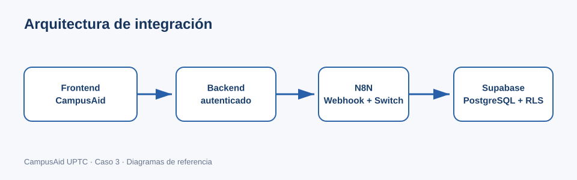
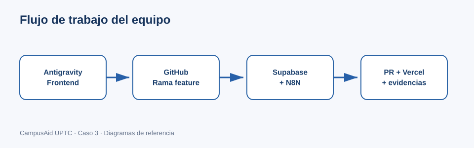

# CampusGest-UPTC

**Mesa de Ayuda y Gestión de Solicitudes Académicas**  
Caso 3 · Taller Full-Stack · Google Antigravity + Supabase + N8N · UPTC



> **Estado del proyecto:** frontend modular y API serverless auditados y fortalecidos bajo estándares de seguridad OWASP. Preparado para la integración de servicios cloud (Supabase PostgreSQL / Auth y N8N Workflow) por parte del responsable de integración.

## Navegación de Documentación

| Documento | Contenido |
|---|---|
| [Inicio rápido](docs/01-inicio-rapido.md) | Orden de trabajo y prerrequisitos del proyecto |
| [Windows PowerShell](docs/02-windows-powershell.md) | Clonar, configurar, ejecutar y versionar |
| [Linux](docs/03-linux.md) | Comandos equivalentes en entorno Bash |
| [Supabase](docs/04-supabase.md) | Configuración del proyecto, SQL, Auth y RLS |
| [N8N](docs/05-n8n.md) | Workflow, credenciales, webhooks y notificación por correo |
| [Integración](docs/06-integracion.md) | Contrato de datos y ruta única de persistencia |
| [Pruebas](docs/07-pruebas.md) | Casos de verificación, matriz QA y evidencias |
| [GitHub](docs/08-github.md) | Estrategia de ramas, Pull Requests y colaboración |
| [Vercel](docs/09-vercel.md) | Despliegue de frontend y variables privadas de API |
| [Solución de errores](docs/10-errores-frecuentes.md) | Diagnóstico básico y preguntas frecuentes |
| [Bitácora de entrega](docs/11-bitacora.md) | Metadatos, requisitos, prompt R-C-I-F-A y reflexión crítica |
| [Guía de imágenes y enlaces](docs/12-imagenes-enlaces.md) | Especificación de rutas relativas y capturas |
| [Guía previa de instalación](docs/13-guia-original.md) | Procedimiento de base ampliado |
| [Seguridad e integración pendiente](docs/14-seguridad-e-integracion-pendiente.md) | **Auditoría de seguridad, correcciones OWASP y guía para el integrador** |

## Flujo de Trabajo y Arquitectura



1. **Frontend (React + Vite + Tailwind CSS):** valida en tiempo real código institucional de 9 dígitos y correo `@uptc.edu.co`.
2. **API Serverless (`/api/solicitudes`):** actúa como proxy seguro hacia N8N. Aplica control de tamaño (50 KB), whitelisting de campos, idempotencia mediante `request_id` y timeout con `AbortController`.
3. **N8N Workflow (`n8n/campusaid-workflow.json`):** recibe la solicitud autenticada, clasifica por `tipo_tramite` mediante nodo Switch, ejecuta inserción parametrizada en PostgreSQL e invoca el envío de correos.
4. **Supabase PostgreSQL & RLS:** gestiona persistencia con políticas Row Level Security para aislar las solicitudes de cada estudiante y restringir la atención a coordinadores autorizados.

## División de Responsabilidades

| Frente | Responsable | Estado / Entregable |
|---|---|---|
| Frontend y Validaciones | Desarrollo Frontend | Formulario reactivo, paneles protegidos y suite QA local |
| Seguridad y API Gateway | Full-Stack / Seguridad | `api/solicitudes.js` fortalecida, rechazo de DoS y respuestas honestas |
| Supabase Auth & PostgreSQL | Integrador Cloud | Migración SQL versionada en `supabase/migrations/`, RLS y usuarios reales |
| Workflow N8N & Correo | Integrador Cloud | Workflow parametrizado en `n8n/campusaid-workflow.json` y credenciales SMTP |
| Despliegue en Vercel | Ambos | Despliegue con HTTPS y variables privadas en el servidor |
| Realizar git push (MCP) | integrador bacend | intergración del MCP o IA de manera automática para realizar controles de versiones CI/CD automático |

## Requisitos del Caso 3

- **Trámites soportados:** `Tutoria`, `Laboratorio` y `Certificado`.
- **Código estudiantil:** exactamente 9 dígitos numéricos (`^[0-9]{9}$`).
- **Correo institucional:** terminado exclusivamente en `@uptc.edu.co`.
- **Tabla principal:** `public.solicitudes_campus`.
- **Flujo:** Webhook POST → Validación → Switch → Supabase Insert → Correo → Respuesta JSON.

## Ejecución Local y Pruebas

```bash
# 1. Instalar dependencias limpias
npm ci

# 2. Compilar producción
npm run build

# 3. Ejecutar suite de pruebas de seguridad y contratos
npm test

# 4. Iniciar servidor local de desarrollo
npm run dev
```

---

[Ir a la guía de seguridad e integración pendiente →](docs/14-seguridad-e-integracion-pendiente.md)
