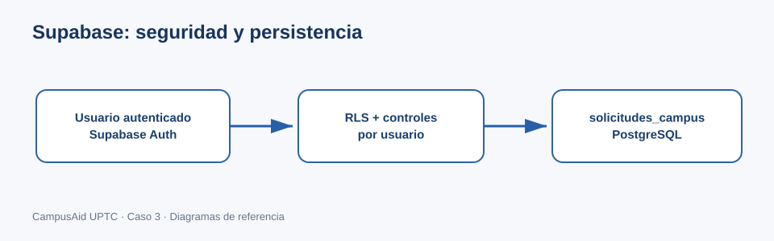

# 04 · Configuración de Supabase

[← Índice](../README.md) · [N8N →](05-n8n.md)



## 1. Crear el proyecto

1. Abrir [Supabase Dashboard](https://supabase.com/dashboard).
2. Crear el proyecto y conservar la contraseña en un gestor de secretos.
3. Copiar **Project URL** y **publishable key** (o `anon` heredada) desde la sección API/Keys.
4. Configurar autenticación. El dominio `@uptc.edu.co` se valida en el formulario **y** en el backend; la autenticación debe verificar la identidad del usuario.
5. En **SQL Editor**, ejecutar las migraciones reales de `supabase/migrations/` en el orden indicado por el proyecto.

## 2. Modelo requerido por la guía

Tabla `solicitudes_campus`:

`id`, `estudiante_nombre`, `codigo_uptc`, `email_institucional`, `tipo_tramite`, `asignatura_o_lab`, `descripcion`, `estado`, `creado_en`.

En [ejemplos/estructura-supabase.sql](../ejemplos/estructura-supabase.sql) se proporciona **una base de referencia** que también vincula solicitudes con el usuario autenticado. Se debe revisar y adaptar antes de ejecutarla. El control administrativo de coordinadores necesita políticas y tablas de roles adicionales.

## 3. Seguridad mínima

- Habilitar RLS para las tablas expuestas al cliente.
- El estudiante ve únicamente sus solicitudes.
- Solo un coordinador autorizado puede editar estados de solicitudes asignadas.
- No crear políticas públicas `FOR ALL USING (true)`.
- Jamás poner la `service_role` o claves `secret` en JavaScript público.
- Evitar tratar una dirección terminada en `@uptc.edu.co` como prueba suficiente de identidad.

## 4. Variables del frontend

```dotenv
VITE_SUPABASE_URL=https://TU_PROYECTO.supabase.co
VITE_SUPABASE_PUBLISHABLE_KEY=TU_CLAVE_PUBLICA
```

Conservar el nombre que realmente espere el código de Antigravity, en caso de utilizar `VITE_SUPABASE_ANON_KEY`.

## 5. Comprobación

1. Crear o iniciar sesión con una cuenta de pruebas válida.
2. Crear un trámite **mediante el flujo autorizado de la aplicación**.
3. Confirmar que aparece en Table Editor.
4. Comprobar que otro usuario no pueda leerlo.
5. Revisar que la solicitud tenga una sola inserción, incluso tras reintentos.

[← Índice](../README.md) · [Siguiente: N8N →](05-n8n.md)
