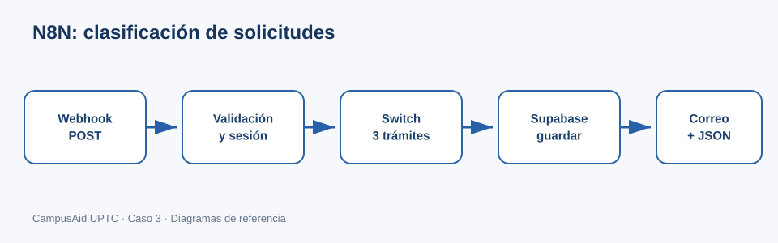

# 05 · Automatización con N8N

[← Índice](../README.md) · [Supabase](04-supabase.md) · [Integración →](06-integracion.md)



## 1. Preparar la instancia

- Utilizar N8N Cloud o una instancia propia accesible por HTTPS.
- Conservar credenciales de Supabase y correo en el almacén de credenciales de N8N.
- No subir exportaciones con credenciales ni tokens.
- Si el proyecto incluye `n8n/campusaid-workflow.json`, importarlo. Si no existe, construir el flujo de esta guía; **esta carpeta no proporciona un workflow funcional ya conectado**.

## 2. Nodos

| Orden | Nodo | Función |
|---|---|---|
| 1 | Webhook | Recibe POST JSON |
| 2 | Validación | Verifica campos y autenticidad del origen |
| 3 | Switch | Ruta Tutoría / Laboratorio / Certificado |
| 4 | Supabase/Postgres | Inserta el trámite una sola vez |
| 5 | Email | Notifica estudiante y coordinador |
| 6 | Respond to Webhook | Devuelve estado y `solicitud_id` |

Ruta sugerida: `campusaid-solicitudes`.

## 3. Clasificación

- `Tutoria` → Coordinación académica.
- `Laboratorio` → Responsable de laboratorios.
- `Certificado` → Responsable de certificados.

La correspondencia de cada coordinador debe cargarse con correos reales autorizados, no supuestos.

## 4. Contrato de respuesta

```json
{
  "status": "ok",
  "solicitud_id": "UUID_REGISTRADO",
  "tipo_tramite": "Tutoria",
  "estado": "Pendiente"
}
```

Devolver errores HTTP adecuados si falla autorización, validación o persistencia. Si falla únicamente el correo después de guardar la solicitud, informar el estado real y manejar el reintento **sin crear otro registro**.

## 5. Pruebas y publicación

1. Abrir el workflow y usar **Listen for test event** cuando corresponda.
2. Ejecutar una solicitud autorizada desde el frontend o backend de prueba.
3. Revisar cada nodo y el registro en Supabase.
4. Activar o publicar el workflow según la versión de N8N.
5. Configurar la **Production URL** exclusivamente en el backend seguro.
6. Consultar **Executions** y conservar captura de una ejecución real exitosa.

**Seguridad:** no llamar a un webhook con credenciales privadas desde el navegador. El frontend debe comunicarse con un backend que valide la sesión y luego envíe la solicitud a N8N. Evitar endpoints no autenticados en producción.

[← Índice](../README.md) · [Siguiente: Integración →](06-integracion.md)
