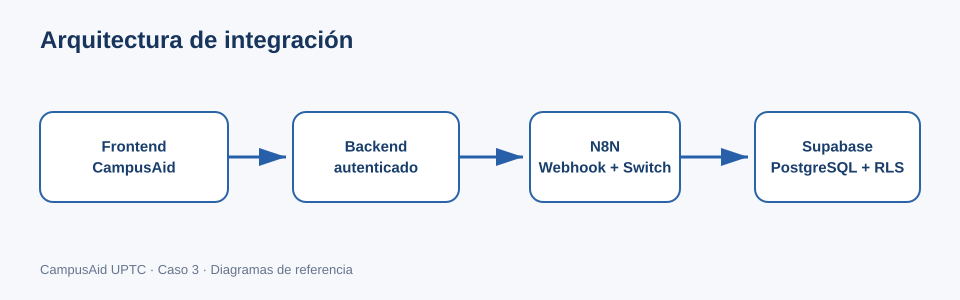

# 06 · Integración frontend, Supabase y N8N

[← Índice](../README.md) · [Pruebas →](07-pruebas.md)



## Ruta única de escritura

1. El estudiante inicia sesión mediante Supabase Auth.
2. El formulario valida código, correo, tipo y descripción.
3. El frontend envía el formulario a un **backend autenticado**.
4. El backend verifica la sesión y reenvía la solicitud a N8N.
5. N8N clasifica y registra la solicitud **una sola vez** en Supabase.
6. La respuesta devuelve el ID generado; la interfaz actualiza la vista consultando Supabase con RLS.

No crear el mismo registro desde el SDK del frontend y desde N8N. El SDK del cliente puede encargarse de autenticación y lectura con permisos.

## Contrato sugerido

```json
{
  "estudiante_nombre": "Estudiante de prueba",
  "codigo_uptc": "123456789",
  "email_institucional": "prueba@uptc.edu.co",
  "tipo_tramite": "Tutoria",
  "asignatura_o_lab": "Programacion II",
  "descripcion": "Solicitud de tutoria",
  "request_id": "UUID_UNICO_POR_ENVIO"
}
```

`request_id` es una extensión recomendada para idempotencia; si se implementa, la base y el backend deben soportarla y verificar los reintentos. El `estudiante_id` debe proceder de la sesión autenticada, no de un campo libre del navegador.

## Checklist de acoplamiento

- [ ] Nombres de campos iguales en UI, backend, N8N y SQL.
- [ ] Valores permitidos `Tutoria`, `Laboratorio`, `Certificado` documentados.
- [ ] `solicitud_id` devuelto tras una inserción confirmada.
- [ ] El estado inicial es `Pendiente`.
- [ ] La interfaz solo muestra registros autorizados.
- [ ] La URL de N8N no está en una variable pública `VITE_`.
- [ ] Se controlan errores de red, timeout y correo sin duplicaciones.

[← Índice](../README.md) · [Siguiente: Pruebas →](07-pruebas.md)
