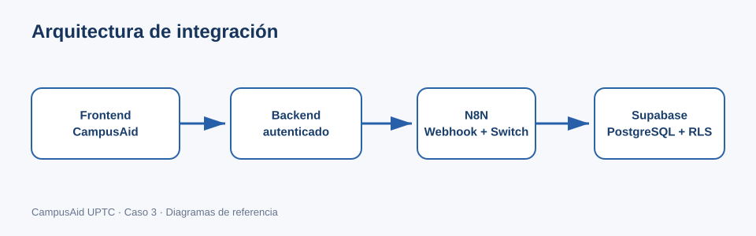

# 08 · Colaboración en GitHub

[← Índice](../README.md) · [Pruebas](07-pruebas.md) · [Vercel →](09-vercel.md)

## Ramas

- Rama base: `main` (o la que indique el responsable del proyecto).
- Integración: `feature/integracion-supabase-n8n`.

## Preparar el Pull Request

Ejecutar desde la carpeta del repositorio, en PowerShell o Bash:

```bash
git status
git diff
git add -A
git status
git diff --cached --stat
git commit -m "feat: integrar supabase y n8n"
git push -u origin feature/integracion-supabase-n8n
```

Antes del staging, confirmar que no se están agregando `.env.local`, credenciales, contraseñas, imágenes con datos reales ni archivos ajenos.

Abrir GitHub → **Compare & pull request** → rama de integración hacia rama base. Incluir: cambios, migraciones, configuración pendiente y pruebas ejecutadas.

## Actualizar la rama

Si la rama base avanzó:

```bash
git fetch origin
git switch feature/integracion-supabase-n8n
git merge origin/main
```

Si la rama base no es `main`, sustituirla. Resolver conflictos editando los archivos afectados, ejecutar las pruebas y confirmar el merge antes de hacer push. No sobrescribir trabajo ajeno con `git push --force`.

## README, imágenes y navegación

Rutas desde el README raíz:

```markdown
[Supabase](docs/04-supabase.md)

[Ir a las pruebas](docs/07-pruebas.md)
```

Rutas desde `docs/`:

```markdown
[Volver al índice](../README.md)

```

Consultar [Guía de imágenes y enlaces](12-imagenes-enlaces.md).

[← Índice](../README.md) · [Siguiente: Vercel →](09-vercel.md)
