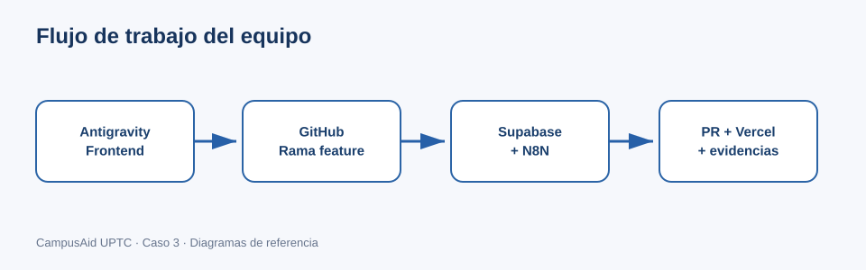

# 12 · Imágenes, redirecciones y enlaces Markdown

[← Índice](../README.md)

## 1. Enlaces entre documentos

Desde el `README.md` de la raíz:

```markdown
[Instalar en Windows](docs/02-windows-powershell.md)
[Configurar N8N](docs/05-n8n.md)
```

Desde un archivo dentro de `docs/`:

```markdown
[Volver al README](../README.md)
[Ir a Supabase](04-supabase.md)
```

## 2. Saltos dentro del mismo archivo

```markdown
[Ir a configuración](#configuración)

## Configuración
```

GitHub construye anclas a partir de encabezados: minúsculas, guiones en lugar de espacios y sin signos diacríticos cuando corresponda. Confirmar visualmente el ancla en GitHub antes de compartirla.

## 3. Imágenes

Desde `README.md`:

```markdown

```

Desde `docs/`:

```markdown

```

Para una captura, colocar el PNG en `assets/capturas/` y usar su ruta relativa. Evitar espacios, tildes y mayúsculas variables en nombres de archivo.

## 4. Diagramas incluidos

- [Arquitectura](../assets/diagramas/arquitectura.svg)
- [Flujo de trabajo](../assets/diagramas/flujo.svg)
- [N8N](../assets/diagramas/n8n.svg)
- [Base de datos](../assets/diagramas/datos.svg)

Todos son SVG locales incluidos dentro de esta carpeta; GitHub los muestra sin servicios externos.

## 5. Buenas prácticas

- Usar enlaces relativos para archivos del repositorio.
- Usar enlaces HTTPS para documentación externa.
- Revisar cada vínculo desde GitHub tras hacer push.
- No insertar capturas que contengan correos reales, tokens o claves.
- No utilizar nombres de archivos que cambien entre Windows y Linux solo por mayúsculas.

[← Índice](../README.md)
